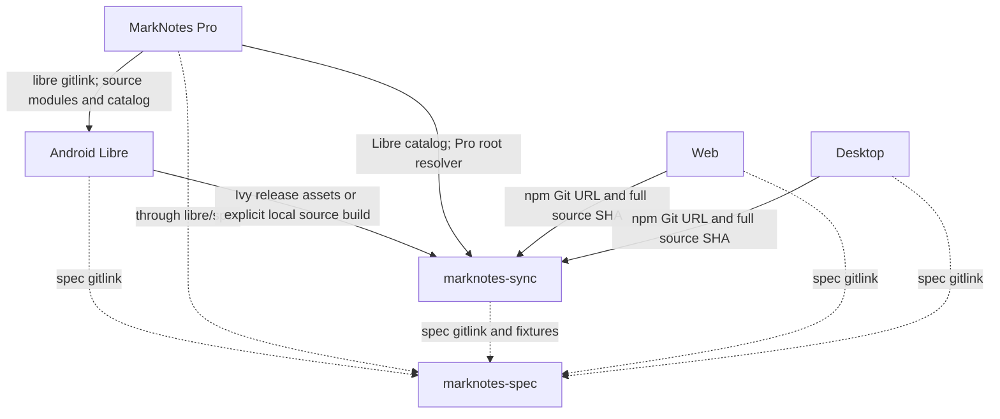

# MarkNotes architecture and ownership

This is the ecosystem map, not another note-format specification. The normative contract
is [note-format.md](../note-format.md); supported behavior and exceptions belong in
[features.md](../features.md) and [fixtures](../fixtures).

Read [dependency consumption](dependencies.md), [release coordination](releasing.md) and
[agent workflows](agents.md) for the mechanics behind this map.

## Repositories

| Repository | Owns | Direct upstreams | Downstream responsibility |
| --- | --- | --- | --- |
| [marknotes-spec](https://github.com/MaxDac/marknotes-spec) | Format, behavior, fixtures, parity matrix, common agent procedures | None in this ecosystem | Notify every runner when fixture mappings or contracts change |
| [marknotes-sync](https://github.com/MaxDac/marknotes-sync) | Rust algorithms, reference executor, Kotlin and npm/WASM bindings, release assets | Pinned spec | Supply compatible APIs, generated artifacts, migration and toolchain evidence |
| [marknotes-android](https://github.com/MaxDac/marknotes-android) | Libre app, shared Android modules, Android executor, Dropbox, F-Droid build | Spec; sync release assets and source pin | Keep shared modules/catalog usable by Pro and describe API changes |
| [MarkNotes](https://github.com/MaxDac/MarkNotes) | Pro host, OneDrive/Proton integrations, Pro build and distribution | Pinned Libre source, including its nested pins/catalog | Adapt Pro connectors and root build when Libre changes |
| [marknotes-electron](https://github.com/MaxDac/marknotes-electron) | Desktop executor, local store, Electron processes, providers, installers/updater | Spec; sync Git source package | Verify real process, persistence and packaged-app integration |
| [marknotes-web](https://github.com/MaxDac/marknotes-web) | Browser executor, storage/security, browser providers, PWA, static hosting | Spec; sync Git source package | Verify browser/CSP/offline behavior and deployment separately |

There are four app editions but three fixture keys: Libre and Pro use `android`,
Desktop uses `desktop`, Web uses `web`. Provider availability is not identical between
editions. Consult the feature matrix, not a repository's name, for support.

## Dependency graph

Arrows point from a consumer to what it consumes. A dashed edge is a behavior contract,
not a downloaded runtime library.

Source, binary and fixture edges advance independently. A new upstream release changes
none of these pins by itself. Pro's nested source tree can intentionally be older than
Libre main; inspect its actual `libre` gitlink before making claims about Pro.

## Sync is shared logic, not a shared backend

The Rust library is sans-I/O: it receives snapshots/content/state and produces plans,
reconciliation results, merge results, manifests and scheduler decisions. It also
provides shared path, ID, front-matter and hashing helpers.

The apps still own complete listings, transport/authentication, provider revision
mapping, conditional writes/deletes, create-only operations, local hash rechecks,
durable journals, transactions, base contents and recovery. The upstream
[executor contract](https://github.com/MaxDac/marknotes-sync/blob/main/docs/executor-contract.md)
defines these obligations. Passing pure planner fixtures is not proof of safe execution.

In particular, declaring a provider unable to remove folders atomically must preserve
the remote folder and the required notice lifecycle. It does not authorize recursive
deletion or treating an unexpected provider failure as a successful mutation.

The reference executor and binding observations test the shared contract; application
executor tests exercise application persistence and races. Both kinds are needed.
See [fixture consumption](../README.md#how-apps-consume-this-repository).

## How Pro consumes Libre

Pro's root Gradle build includes:

| Project | Source owner | Role |
| --- | --- | --- |
| `:core` | `libre/core` | JVM/domain model, sync executor and shared contracts |
| `:app-shared` | `libre/app-shared` | Compose UI, settings, Room, credentials, Dropbox and app wiring |
| `:pro-core` | Pro | Pro provider/domain and authentication code |
| `:proton-drive` | Pro | Proton SDK adapter and native integration |
| `:app` | Pro | Application identity, Pro host/connector wiring, manifest and release configuration |

This is one build with source projects, not `includeBuild`, a downloaded Libre AAR,
an APK dependency or a source-copy process. Libre's own `:app`, wrapper and root settings
are not used as Pro's build root.

Pro names its root catalog `pro` and imports Libre's catalog as `libs`. Shared plugin and
dependency versions remain upstream-owned; Pro-only versions remain in `pro`.
Library manifests/resources merge through ordinary Android dependencies. Pro supplies
its own application identity and host while using shared activities/resources.

`ProApp` subclasses the shared `MarkNotesApp`. `extraConnectors` adds OneDrive and
Proton to the shared container's Dropbox connector. Changes to `MarkNotesApp`,
`AppContainer`, `DriveConnector`, `RemoteDriveStore`, exported model types or catalog
aliases can therefore require a Pro adaptation even without a note-format change.

Pro owns its root repositories and verification policy. Including Libre modules does
not activate Libre root scripts or root `gradle/verification-metadata.xml`.
See [Android and Pro consumption](dependencies.md#android-and-pro).

## Desktop process boundaries

The renderer owns the local note store, sync manager and executor. Its remote-store
adapter calls the typed `window.marknotes` bridge through the sandboxed preload.
Main owns account/provider I/O, credential/key integration, packaging and updates.
Context isolation and renderer sandboxing are not reasons to move provider secrets
into renderer code.

Shared core imports occur in the renderer, Node tests and main-process OneDrive helpers.
Do not assume the WASM package needs to work only in a browser renderer.
Desktop's provider adapters and durable metadata must satisfy the executor contract
even though the algorithm comes from Rust.

## Web has no notes server

Web compiles TypeScript/Vite into a static shell served by Caddy. Browser storage owns
notes, attachments, sync metadata and credentials; browser adapters contact providers
directly. The production container does not run Node, Rust or a sync service.

The service worker caches the fixed public shell, not private content or tokens.
An asset being cached offline does not provide background sync while the app is closed.
Source-package generation happens during the build; the browser consumes its output.

## Routing a change

| Change | First implementation owner | Other surfaces to evaluate |
| --- | --- | --- |
| Note/sync semantics or expected fixture output | Spec, then sync for shared algorithms | All mapped runners, app executors, feature matrix |
| Planner, merge, manifest or scheduler API | Sync | Both binding surfaces, all consumers, toolchain/API migration |
| Provider conditional operation or durable recovery | Affected app executor/adapter | Executor contract, app safety tests, shared behavior if changed |
| Shared Android UI/API/catalog | Libre | Pro source compatibility, merged resources/permissions, provider adapters |
| Pro-only auth/provider SDK | Pro | Shared connector contract, SDK/core compatibility, ABI/permissions |
| Packaging, lifecycle policy or hosting tool | Affected app/build owner | Install/build/production contracts and actual distribution |
| Documentation or agent procedure only | Spec for common rules; app for local map | Link/skill discovery, avoid unnecessary runtime/fixture bumps |

Do not fork shared algorithms into an app to avoid an upstream fix, or force every
local maintenance task into a six-repository implementation.

## Evidence and freshness

The initial map was checked against spec `8251801`, sync `48bdbde`, Libre `eafa1af`,
Pro `d7c1fc9`, Desktop `50911b9` and Web `6bb1f88`. Full revisions and pinned-tree
evidence are in the [dependency snapshot](dependencies.md#audited-snapshot).
These identify an audit, not a promise that moving `main` links will stay unchanged.
